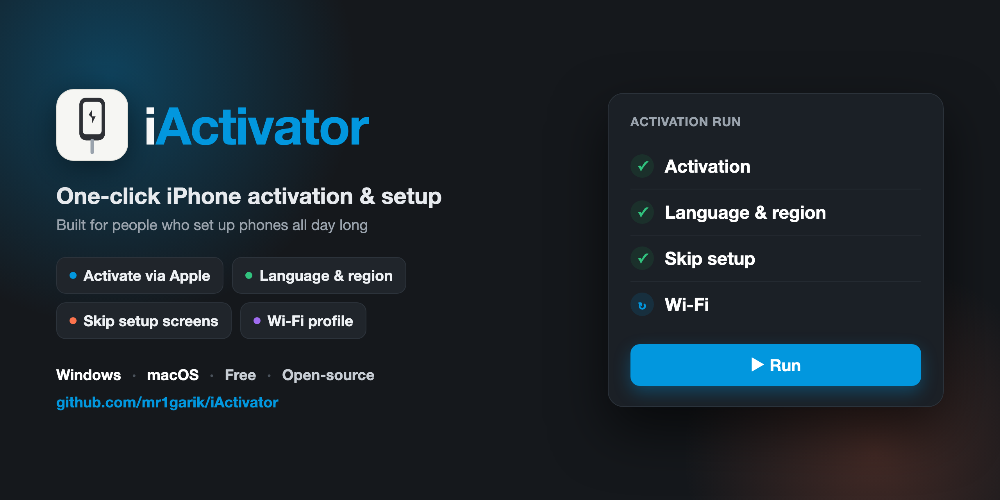
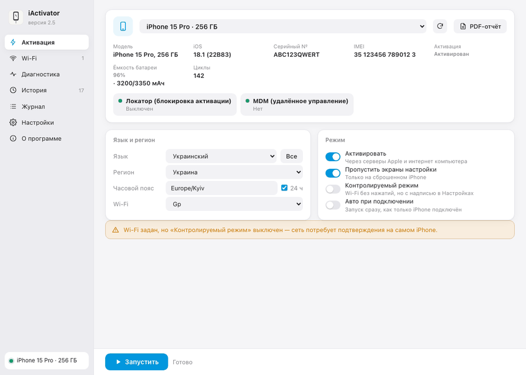
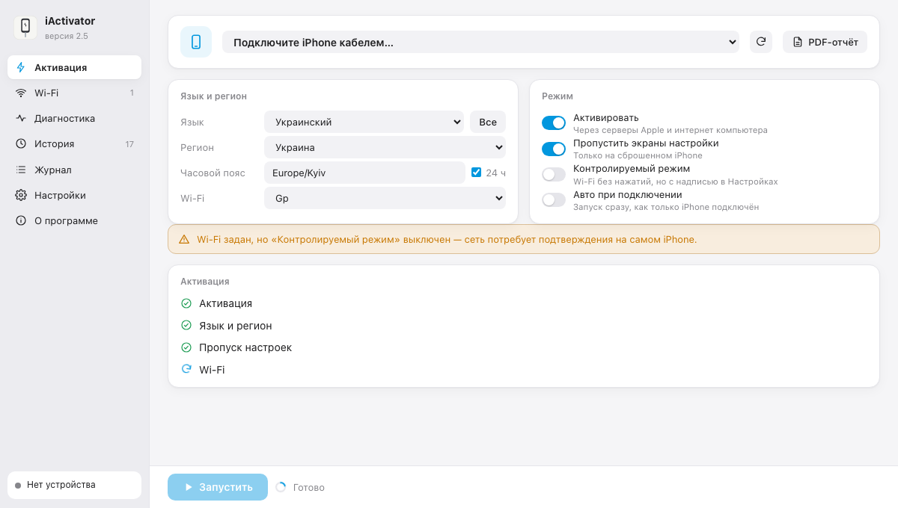
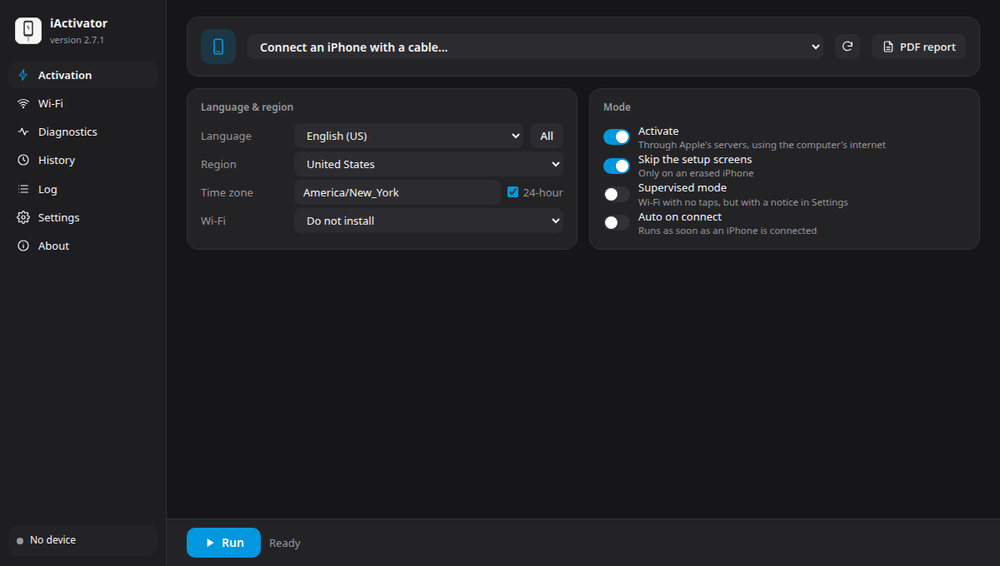

### One-click iPhone activation and setup | Windows and macOS

[Download](https://github.com/c12n/iactivator-English/releases/latest) | [How it works](#how-it-works) | [FAQ](#faq) | [Report an issue](https://github.com/c12n/iactivator-English/issues)

iActivator activates an iPhone and skips the setup screens, with any language and region you choose. This is the **English edition**: the whole interface, log, history and PDF reports are in native English, English (US) and the United States are the defaults, and the built-in update check points at this repository, so an update never switches you back to another language edition. It runs on Windows and macOS.

**Feedback:** found a problem or have an idea? Open the [Issues](https://github.com/c12n/iactivator-English/issues) tab. The program is improved based on your reports.

## What it looks like

Light and dark themes:

  
  

## Features

| | |
|---|---|
| **One-click activation** | Activates the iPhone through Apple's servers. The internet comes from the computer over USB, so the iPhone does not need Wi-Fi for this step |
| **Any language and region** | Sets the language, region (locale, for example `en_US`), time zone and 24-hour format. English (US) is ready out of the box, and the full list can be read straight from the iPhone |
| **Setup screens skipped** | Skips the Setup Assistant screens the same way Apple Configurator and 3uTools do, with an optional supervised mode |
| **Wi-Fi that actually connects** | Installs a Wi-Fi profile and then reads the profile list back from the device to confirm it landed, with up to 3 attempts |
| **Diagnostics** | Battery health and cycles, charging, Wi-Fi and Bluetooth modules, modem, storage, crash logs from the last 30 days, Find My and MDM status |
| **PDF report** | A dated report for each checked iPhone: identity, battery, lock status, every check result, and the step-by-step outcome of the last activation run |
| **History and log** | Every device and action is remembered, the log can be exported for your own archive or in a redacted copy with serial numbers, IMEIs and UDIDs hidden |
| **Portable settings** | Wi-Fi networks, language, region, modes and theme export to a single file and import on another computer |

## Compatibility

| | Support |
|---|---|
| **iPhone models** | iPhone 5s and newer (anything that runs iOS 12 or later). iPads activate too, but the interface is designed for iPhone |
| **iOS versions** | iOS 12 to 18. Setup skipping and the Wi-Fi profile work on iOS 13 and later; on older versions activation completes, but some settings may not apply |
| **Windows** | Windows 10 and 11. An Apple driver is required: Apple Devices from the Microsoft Store, or iTunes. System tray icon and start-with-Windows are included |
| **macOS** | macOS 11 Big Sur and later (Intel and Apple Silicon). No drivers needed. Controls live in the top menu bar |
| **Activation Lock (iCloud)** | Not bypassed. An iPhone linked to someone else's Apple ID has to be removed from the owner's account |

If a model or iOS version behaves differently for you, say so in [Issues](https://github.com/c12n/iactivator-English/issues) and the table will be updated.

## How it works

1. **Activation.** The iPhone activates through Apple's servers over the computer's internet connection, passed over USB.
2. **Language and region.** Language, region (locale), time zone and 24-hour format are applied.
3. **Setup screens.** A cloud configuration skips the Setup Assistant screens, as in Apple Configurator and 3uTools. With supervised mode on, Wi-Fi also installs with no taps on the phone.
4. **Wi-Fi.** The Wi-Fi profile is installed last, once setup is finished, and the program verifies the device accepted it.

An iPhone with Activation Lock (iCloud) turned on cannot be activated by this program: the owner's Apple ID is required.

### Why Wi-Fi from 3uTools sometimes does not work, and what is done here

| Cause | Fix here |
|---|---|
| The security type is hard-coded as WPA while the router runs WPA3 or WPA2/WPA3 mixed mode | `Any` is the default: iOS negotiates the protocol itself |
| Private Wi-Fi Address (randomized MAC) is blocked by MAC filtering or a DHCP reservation | An option turns the randomized MAC off for that network |
| After setup is skipped, the Wi-Fi radio stays off | The radio is switched on before the profile is installed |
| The profile is installed without supervisor rights and nobody can confirm it during setup | The profile installs silently after escalation with the supervisor certificate |
| Spaces in the SSID, or a password that is too short | Checked before anything is sent to the device |
| The profile failed to install and the program never said so | The profile list is read back from the device after installation, with up to 3 attempts |

## The program

The interface opens in its own app window (WebKit on Mac, Edge WebView2 on Windows).

- **Mac:** `dist/iActivator.app`. It can be moved to Applications. Build it with `./build_mac.sh`.
- **Windows:** `iActivator.exe`. Build it on a Windows computer by double-clicking `build_windows.bat` (Python from python.org is required). Or push the folder to GitHub and run the **build** workflow from the Actions tab: GitHub builds both the `.exe` and the Mac version, and a version tag publishes them as a release.
- On Windows, working with an iPhone requires Apple Devices from the Microsoft Store, or iTunes.

## Settings, log and history

- **Theme:** System, Light or Dark (in Settings).
- **Moving settings:** Settings, then Save to file, writes your Wi-Fi networks, language, region, modes and theme into one `.json` file. Wi-Fi passwords, the supervision key and device history can go into the same file if you choose. On the other computer: Load from file. Passwords in the file are not encrypted.
- **Log:** every entry has a time, a device and a level. Filters: main, errors only, and detailed (with technical error information). Daily logs are kept in the `logs` folder inside the data folder for 30 days. Export to file bundles the whole log and device history into one text file for your own archive. The "For sending (numbers hidden)" button does the same but hides serial numbers, IMEIs and UDIDs and leaves the history out, so the file is safe to send for review.
- **History:** devices, what was done with them, and the results, with totals for all devices, today, activated, and with warnings. The history also sits in a spreadsheet file that opens in Excel.

## Updates

- On launch, the program quietly checks this repository on GitHub. If a new version is out, a bar with a Download button appears at the top of the Activation tab and opens the download page.
- Check by hand: About, then Check for updates.
- An update replaces only the program itself. Device history and settings live in a separate data folder and are never lost in an update.

## During a run

- **Review before running.** After you press Run, a window shows a summary of exactly what will be applied to the iPhone: device, activation, language, region, time zone, setup skipping, supervised mode and the Wi-Fi network. The run starts only after you confirm in that window. In Auto on connect mode the window is not shown.
- While it works, a step list appears under the Mode card: activation, language and region, setup skipping, Wi-Fi. Each step is marked done, failed, or in progress.
- If a Wi-Fi network is set but Supervised mode is off, a yellow note above the list warns that the network will need confirmation on the iPhone itself.
- The PDF report gains an "Activation progress (last run)" section with the result of each step, so you can see exactly what failed (for example, activation passed but the iPhone rejected the Wi-Fi profile) without repeating the whole procedure.

## Window and background

- The window fits itself to the screen (so it never spills past the edges at 125% to 150% scaling on Windows) and remembers its size and position.
- **Windows:** tray icon. The close button tucks the program into the tray; quit from the icon's menu, and reopen the window from there too.
- **Windows, Settings, Startup:** a "Start with Windows" option for launching at sign-in.
- **macOS:** Show window and Quit items in the top menu bar.
- On Windows the built-in browser runs leaner, using less memory.

## Good to know

- The supervision key is stored in `%APPDATA%\iActivator` (Windows) or `~/Library/Application Support/iActivator` (Mac). If you lose it, the iPhone has to be erased before settings can be applied again.
- If the iPhone already carries a configuration from 3uTools or another computer, press Erase device first.
- This program does **not** bypass iCloud Activation Lock. It is for your own or erased devices.

## FAQ

**Does it bypass Activation Lock?**
No. An iPhone linked to someone else's Apple ID has to be removed from the owner's account, at icloud.com/find or with the owner's password on the device.

**Does the iPhone need Wi-Fi or a SIM to activate?**
No. Activation uses the computer's internet connection over the USB cable.

**What is supervised mode, and do I need it?**
It lets the Wi-Fi profile install with no taps on the iPhone. The trade-off: Settings shows "This iPhone is supervised and managed by…" at the top until the device is erased. It is optional and off by default.

**Where do my settings and history live?**
In a data folder separate from the program (`%APPDATA%\iActivator` on Windows, `~/Library/Application Support/iActivator` on Mac), so updates never touch them.

**Is this the original project?**
No. This is the English edition of [iActivator by mr1garik](https://github.com/mr1garik/iActivator), translated and maintained by c12n Apps. The original author and his support links are credited in the app's About tab and in the license below.

## Roadmap

| | |
|---|---|
| **English edition upkeep** | Keep this edition in step with upstream iActivator releases, translated as they land |
| **Refreshed screenshots** | Replace the gallery with captures of the English interface |
| **Broader iOS coverage** | Extend the compatibility table as new iOS versions are verified on real devices |

## License

MIT: free to use, modify and distribute. See [LICENSE](LICENSE).

This repository is an English translation of iActivator. Copyright (c) 2026 mr1garik for the original work (see LICENSE) | English edition maintained by c12n Apps.
